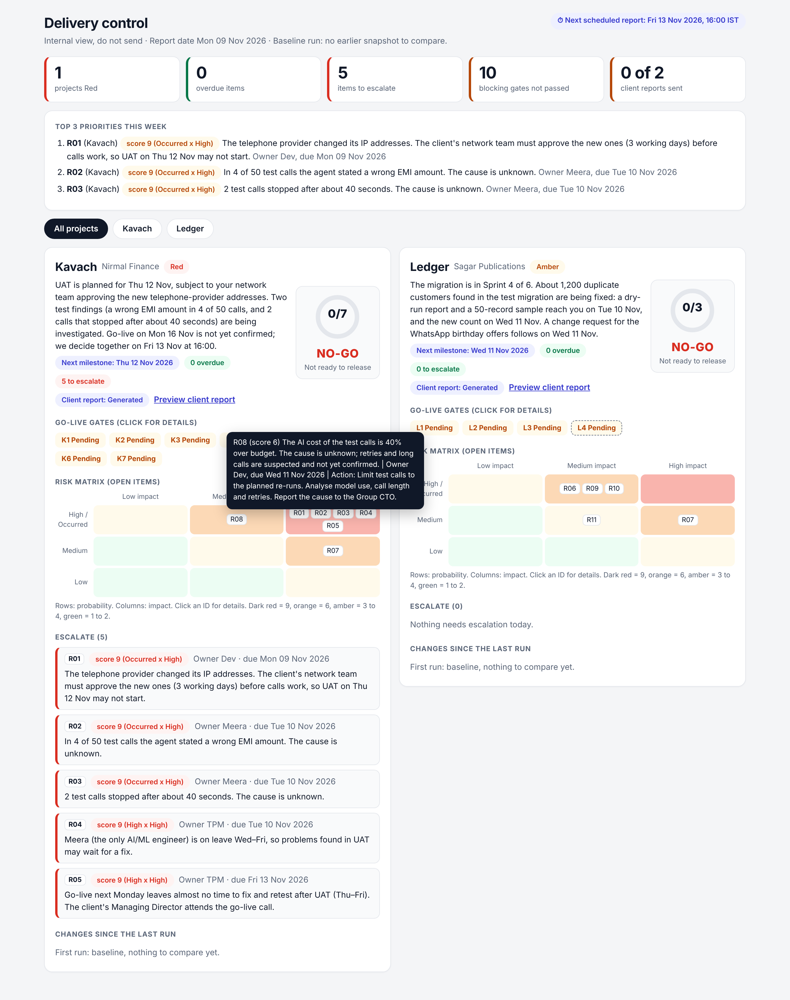

# Delivery Control
**A weekly status and go/no-go tool for a TPM running several client projects.**


**The problem (from the PSI case):** Friday's client report was missed, the COO had to ask for it, and nobody could say quickly whether Kavach was ready to go live.
**What this does:** one command reads the tracker and a gates file, then writes a client report and an internal brief per project, a dashboard, and a "reviewed / sent" record. A GitHub Action runs it every Friday at 16:00 IST. There is no AI inside the tool, so a report can never contain an invented fact.



## Run it (Node 18.3+)
```
npm ci
node status_report.js data/tracker.xlsx --gates data/gates.csv --date 2026-11-09
npm test                                   # 29 tests, including one on the real tracker
```
Open `reports/2026-11-09/dashboard.html` (double-click). Other commands:

| Command | What it does |
|---|---|
| `... --check` | Validates the tracker and gates only. Writes nothing. |
| `... --no-snapshot` | Trial run that does not change the saved snapshot. |
| `node delivery.js mark 2026-11-09 Kavach Reviewed` then `Sent` | Records the send. `Sent` is refused before `Reviewed`. |
| `node delivery.js status 2026-11-09 --strict` | Lists unsent reports; exits 1 if any is past 17:00 IST. |

Outputs per run: `<Project>_client_report.md` (only `Share with client = Y`), `<Project>_internal_brief.md` (do not send), `client_preview.html` (the client report as they will read it), `dashboard.html`, `delivery.json`. A finished example is in `sample_output/`.

## Decisions I made (and why)
- **Escalate = overdue, or score 9.** Score 6 or more flags 10 of 11 items, so it would tell the CTO nothing.
- **GO needs every required, blocking gate to pass.** Nothing is assumed passed. The 40% cost overrun is its own gate (K6). An optional gate never blocks, and never counts in "conditions met".
- **Bad data stops the run** with the item named. A wrong report sent to a client is worse than a late one.
- **Dates are text (`2026-11-09`), and "today" is the India date.** The GitHub runner uses UTC, so a plain `new Date()` can be a day behind at 16:00 IST.
- **"Reviewed" expires.** Each client report is hashed. If the text changes after review, it goes back to *Generated* with a warning.
- **Delivery tracking is advisory.** It records what I tell it; it cannot know that an email arrived. The tool says so.

## Edge cases I tested for (each has a test)
| Case | Result |
|---|---|
| Project name misspelt ("Kavch") | Stops. Otherwise the item vanishes from every report. |
| Blank row in the middle of the tracker | Stops, names the row below it. Otherwise items are silently cut off. |
| Owner, due date, probability or Y/N flag missing | Stops with the ID. |
| Duplicate ID, gate for an unknown project | Stops. |
| Colour key and notes under the table | Ignored; the table ends at the first blank row. |
| Item with project `Both` | In both projects, once in the Top 3. |
| Gate past its due date and not passed | Marked OVERDUE. |
| `\|` or a line break inside a description | Escaped; the Markdown table survives. |
| Item deleted from the tracker | Shown as a change, not silently dropped. |
| `<script>` typed into a tracker cell | Escaped on the dashboard. |
| 16:59 vs 17:00 IST, and UTC date one day behind | Tested at the boundary. |
| Missing file, unknown flag, missing sheet | One-line `STOPPED:` message, exit 1, no stack trace. |

## How I worked with the AI
I decided the rules (escalation, go/no-go, what the client may see) and gave the AI those, not "build me a status tool". I then ran the output against the real tracker and against deliberately broken copies of it. The full prompt is just below. After it: the errors the AI made, and what I did.

### The prompt I gave the AI

I didn't get to this prompt in one attempt. I started with a basic idea of automating weekly status reports and then went through 2–3 iterations with AI to make the requirements clearer. I used AI to help identify missing scenarios, improve the structure of the prompt and think through edge cases. The final version below is what I gave the AI coding assistant to build the tool.

<details>
<summary><b>Click to read the final prompt (about 80 lines)</b></summary>

I'm working on a TPM assignment and want to build a small Node.js tool that automates weekly project reporting.

I manage two client projects, Kavach and Ledger. The problem I'm trying to solve is simple: weekly reporting takes time, and missing an update can lead to unnecessary client escalations. I want the tool to generate the reports, but I also want enough checks in place so that I don't end up sending incorrect or incomplete information.

I've attached two files: `tracker.xlsx`, which has the project summary and risks/issues, and `gates.csv`, which has the go-live conditions.

Before writing the code, please go through both files and tell me what sheets, columns and data you found. Don't change the original files.

Here's what I need:

#### Technology and input handling

Use Node.js with CommonJS. I'd prefer `exceljs` for reading Excel and Node's built-in test runner instead of adding a testing framework.

Read Excel columns using their headers, not fixed column numbers, because the tracker format might change. Also, there are some notes and colour legends below the actual tables, separated by a blank row. Those shouldn't be read as project data.

#### Risk calculations and escalations

Please follow these rules exactly:

- Recalculate the risk score as Probability × Impact. Occurred and High should count as 3, Medium as 2 and Low as 1. Don't trust the Score column already present in Excel.
- An item is overdue only when it's Open or In progress and its due date is before the reporting date.
- Escalate an item if it's overdue or its score is 9. Mention the reason next to it. I don't want to escalate at score 6 because that would create too much noise.
- Some risks are marked `Both`. Include those in both Kavach and Ledger reports.

#### Go-live readiness

Use `gates.csv` to calculate GO/NO-GO. Only gates that are both required and blocking should affect the decision.

If all those gates have passed, show GO. If any are Pending, Blocked or Fail, show NO-GO and mention what's blocking the release. If the gate data is missing or invalid, show REVIEW. Please don't assume a gate has passed just because information is missing.

#### Data validation

This is important because I don't want a report that looks correct but has silently missed something.

Before generating reports, check for missing owners, invalid dates, incorrect probability or impact values, duplicate risk IDs, unknown project names, invalid statuses and incorrect Y/N flags.

If something is wrong, stop and show a useful error with the item ID or row number. Don't just skip the record or print a long stack trace.

Keep dates in `YYYY-MM-DD` format. Excel date conversion can cause timezone issues, so avoid shifting dates by a day. The report date should default to today's date in IST, but I should also be able to pass it through `--date`.

#### Reports and dashboard

For every project, generate two Markdown reports:

- A client report with the project status, client summary, next milestone, open risks and changes since the previous report. Only include risks marked `Share with client = Y`. Don't expose internal issues, owners or internal notes.
- An internal brief with the GO/NO-GO decision, blocking gates, escalations with reasons, upcoming actions sorted by due date and anything intentionally excluded from the client report.

Also create a single `dashboard.html` for both projects. It should show the project status, readiness gates, risk matrix, escalations and key changes. Keep it clean, responsive and usable offline. Basic JavaScript is fine; I don't want a frontend framework for this.

Add a separate client-preview page so I can review exactly what will be shared before sending it.

#### Weekly comparison and delivery tracking

Save the latest report data in `snapshots/latest.json` and compare the next run against it. The first run should be treated as a baseline. I want to see new, resolved, improved, deteriorated and changed risks.

Also track each client report through Generated, Reviewed and Sent. The tool shouldn't assume a report has been sent just because it was generated. If the report changes after review, its delivery status should reset.

#### Running the tool

I want to run it from the command line, for example:

`node status_report.js data/tracker.xlsx --gates data/gates.csv --date 2026-11-09`

Also add a `--check` option to validate the files without generating reports, and `--no-snapshot` for trial runs.

Set up GitHub Actions to run every Friday at 4 PM IST. Since GitHub uses UTC for cron, use `30 10 * * 5`. Include a manual trigger as well.

#### Testing and final handover

Use `node:test` and cover the important business rules, but also test cases where things go wrong: missing data, duplicate IDs, invalid project names, blank rows, missing gates, deleted risks and incorrect client-sharing flags.

Please run the tests and also run the tool on my actual tracker. Check the generated reports, especially that internal issues don't appear in client reports and that no pending gate is treated as passed.

If you find an issue, explain what caused it and how you fixed it. Add a regression test where possible.

Finally, create a README explaining how to run the project, the commands, assumptions, limitations, prompts used and at least one AI-generated error that was caught and corrected.

Keep the code straightforward, with short functions and comments where needed. I should be able to understand the logic and explain the technical decisions in an interview. I don't want unnecessary libraries or complicated abstractions just to make the project look bigger.

</details>

### Errors the AI made

| What went wrong | How I found it | Fix |
|---|---|---|
| Misspelt project name silently dropped an item. | Changed "Kavach" to "Kavch" in a copy. | Validation error + test. |
| A blank row mid-table silently hid every item under it. | Deleted a row in a copy. | Detected and reported. |
| "0 of 4 conditions met" counted an optional gate. | Read the client report against `gates.csv`. | Count uses required + blocking gates only. |
| Overdue gates were not flagged. | Set a past due date on a gate. | `gateOverdue`, shown in brief and dashboard. |
| A `\|` in a description broke the Markdown table. | Typed one in. | Escaped. |
| Missing file or sheet printed a raw stack trace. | Deleted the sheet. | Clear one-line message. |
| An item removed from the tracker vanished from the changes list. | Compared two runs. | Reported as "removed". |

I also had a second AI build the same tool and compared the two. Its hand-written Excel parser mis-reads empty cells like `<c r="I3" s="7"/>`: clearing one owner cell shifted that row's columns and the tool still exited 0. I kept the `exceljs` reader and borrowed its delivery-tracking and `--check` ideas, rewritten so I can explain each line.

## Weekly run and limits
`.github/workflows/weekly-report.yml` runs the tests, runs the tool and commits `reports/` and `snapshots/` back to the repo every Friday at 10:30 UTC (16:00 IST). It can also be started by hand from the Actions tab. **Status: not yet confirmed; I will only call it active after one green manual run.** (Replace this line with the result.)

Limits: it runs on a tracker I keep in the repo, not a live Jira or Sheets connection. It does not send email; sending stays a human step, deliberately. Gate status is typed by a person, so the tool is only as honest as that input.

## Files
`status_report.js` rules and reports · `delivery.js` review/sent record · `dashboard.js` the two HTML pages · `data/` tracker and gates · `tests/` · `.github/workflows/` · `docs/` screenshot · `sample_output/`
